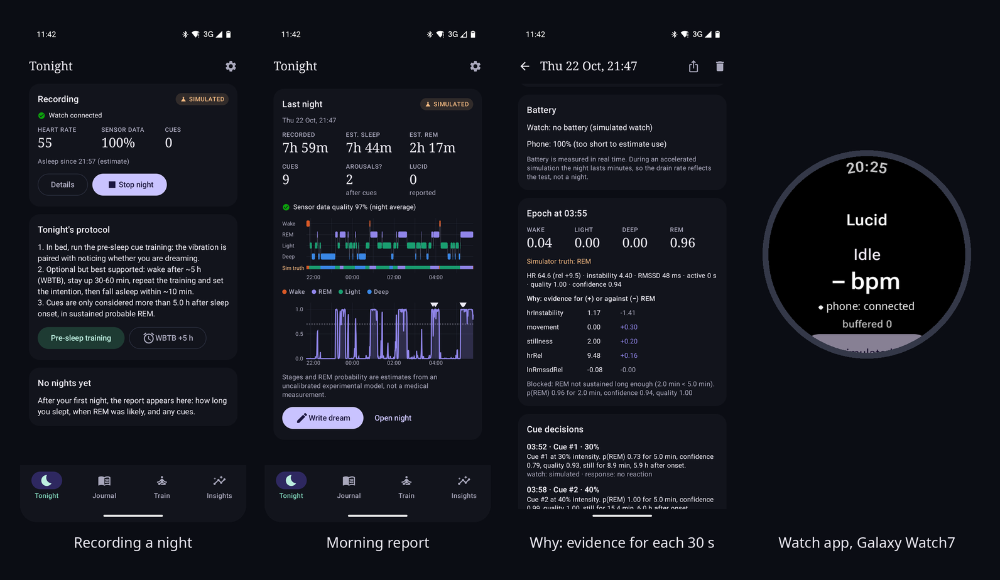

# Lucid

An open-source, experimental lucid-dream induction system for Android and Wear OS.

A Wear OS watch (target: Samsung Galaxy Watch 7) streams heart rate, inter-beat intervals and
movement to an Android phone. The phone estimates the probability of REM sleep and, late in the
night, sends soft vibration cues during sustained probable REM. The same vibration is practised
while awake ("targeted lucidity reactivation"), so that in a dream it can trigger the question
"am I dreaming?".

> **Status:** first version. Runs end to end on the Android and Wear OS emulators and on a real
> Galaxy Watch7 + Android 16 phone (heart rate, beat-to-beat intervals, movement, cues), including
> full recorded nights. The stage model is fitted on 31 sleep-lab nights from another watch
> (85 % of would-be cues land in REM when tested on nights it never saw) but is **not validated on
> the Galaxy Watch**. See [docs/MODEL.md](docs/MODEL.md) and [docs/STATUS.md](docs/STATUS.md).

## Screenshots



Phone screens are from the emulator replaying a simulated night, hence the "SIMULATED" labels.

## What is in the box

| Part | What it does |
|------|--------------|
| `core/model` | Measurement types and the watch/phone wire protocol (pure Kotlin) |
| `core/engine` | The pipeline: validation, 30 s epochs, features, HMM REM estimator, cue policy (pure Kotlin, no simulator access) |
| `core/sim` | Deterministic night simulator: 7 scenarios, seeded, with a simulated watch that buffers and backfills |
| `core/eval` | Command-line tools: replay simulated or recorded nights, fit and test the stage model on sleep-lab data |
| `app` | Android phone app: live monitoring, cueing, night reports, dream journal, training, experiments, statistics |
| `wear` | Wear OS watch app: sensor collection, uplink with acknowledgements, vibration cues |

End-to-end flow, working today:

```
simulated night -> watch measurements -> validation -> epochs -> features -> REM probability
  -> cue decision (with reasons) -> vibration command -> (simulated / emulator) watch -> ack
  -> stored session -> night report, journal, statistics
```

## Quick start

Requirements: Linux x86_64 with KVM, JDK 17, ~15 GB disk. Nothing is installed outside the repo:
the SDK, Gradle cache and emulator images live in `.toolchain/` (git-ignored).

```bash
LUCID_WITH_IMAGES=1 ./scripts/setup-toolchain.sh   # Android SDK + phone/watch emulator images
source scripts/env.sh

./gradlew test                                       # pipeline, simulator and app unit tests
./gradlew :core:eval:run --args="--scenario all"     # replay all simulated nights in ~1 s

./gradlew :app:assembleDebug :wear:assembleDebug
./scripts/emulators.sh --window                      # boots phone + watch emulators, sets up the dev bridge
adb -s emulator-5554 install -r app/build/outputs/apk/debug/app-debug.apk
adb -s emulator-5556 install -r wear/build/outputs/apk/debug/wear-debug.apk
```

Then open Lucid on the phone, turn on Settings → About → **Developer tools**, pick the in-app
simulator as data source and tap **Start simulated night**. A whole night replays in about two
minutes at 240x. Details, including running phone and watch emulators together, are in
[docs/EMULATORS.md](docs/EMULATORS.md).

## Documentation

- [docs/STATUS.md](docs/STATUS.md): what works in the emulator, on synthetic data only, awaiting hardware, or blocked
- [docs/ARCHITECTURE.md](docs/ARCHITECTURE.md): modules, pipeline, estimator, cue policy, protocol, storage
- [docs/MODEL.md](docs/MODEL.md): the stage model, how it was fitted on sleep-lab nights, results and limits
- [docs/EMULATORS.md](docs/EMULATORS.md): build, run and test without a watch
- [docs/HARDWARE.md](docs/HARDWARE.md): bringing up the Galaxy Watch 7 (Samsung Health Sensor SDK, permissions, checks)
- [docs/DATA.md](docs/DATA.md): pull the phone's database and read any night (`scripts/lucid-pull.sh`, `tools/night_report.py`)
- [docs/RESEARCH.md](docs/RESEARCH.md): the science and platform facts the design rests on, with sources

## License

[MIT](LICENSE). The Samsung Health Sensor SDK is not included; download it from Samsung
(see [docs/HARDWARE.md](docs/HARDWARE.md)).

## Safety and honesty

- Not a medical device. Stage estimates are probabilistic and not validated on the Galaxy Watch.
- Simulated data is labelled as such everywhere and excluded from statistics by default.
- Vibration can wake you. Defaults are conservative (no cues in the first 3.5 h, sustained REM
  required, movement lockouts, caps, intensity backs off after any sign of arousal).
- No network permission in release builds; all data stays on the phone unless you export it.
