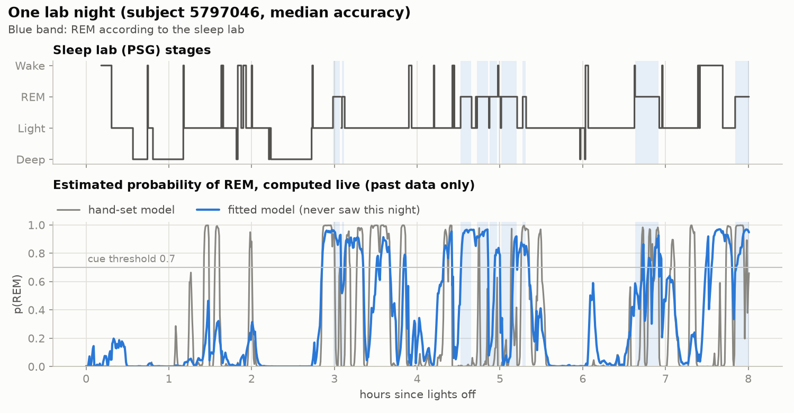
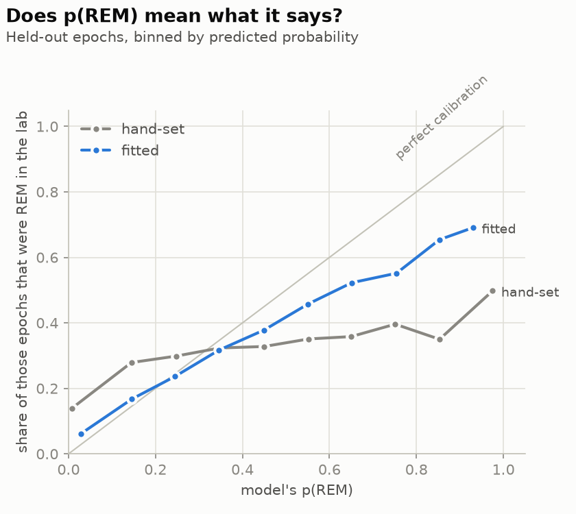
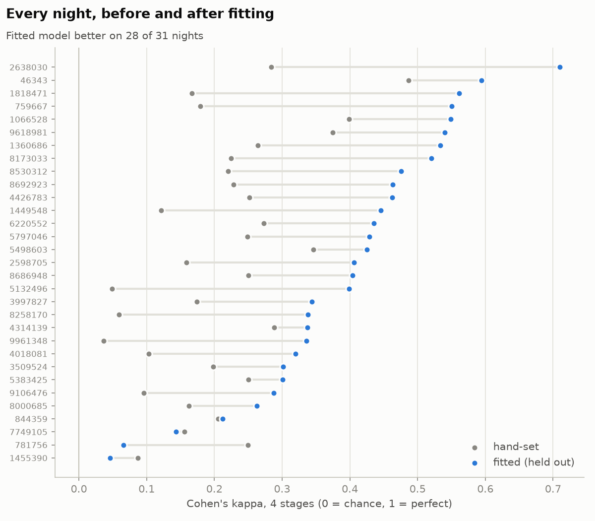
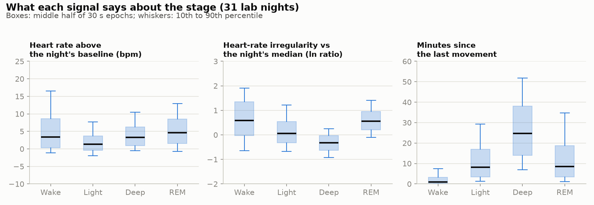
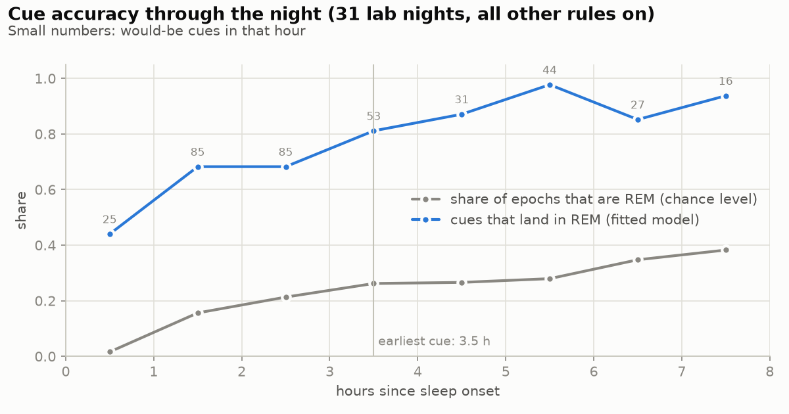

# The stage model and how it was fitted

The phone estimates the sleep stage every 30 s with a small hidden Markov model (HMM). Since
October 2026 its numbers come from 31 sleep-lab nights instead of hand-set guesses. This page
explains the model, how it was fitted and tested, and what it can and cannot do.

Short version: on nights it never saw, the fitted model agrees with the sleep lab far better than
the old hand-set one (Cohen's kappa 0.40 vs 0.22). 85 % of the cues it would send land in real REM,
compared with 65 % for the old model under the same rules. Its probabilities also became honest. It was fitted on Apple Watch
data, so on a Galaxy Watch it is still unvalidated.

## The model

Four hidden states: wake, light (N1 + N2), deep (N3) and REM. Every 30 s epoch gives four
observations, all computed on the phone from the watch's 1 Hz heart rate and per-second motion
summaries:

| feature | what it is |
|---|---|
| `hrRel` | mean heart rate minus the night's sleeping baseline (20th percentile of quiet epochs so far), bpm |
| `hrInstability` | ln of the heart rate's standard deviation over the last 2.5 min, minus the night's median of that value |
| `movement` | seconds in the epoch with a real movement: activity more than 40 mg above the wrist's resting level, or a rotation over 3° |
| `stillness` | minutes since the last movement |

For each stage the model holds a histogram of every feature. The transition table (how likely each
stage is to follow another) changes with the hours since sleep onset. A forward filter combines
the two using past data only, so the estimate is available live during the night. Each feature's
evidence is raised to a weight below or above 1 (a tempered likelihood). That matters because the
heart-rate features use overlapping windows. Without the weights the filter would count the same
evidence several times and become overconfident.

The whole model is about 100 numbers in
[`hmm-walch-v1.json`](../core/engine/src/main/resources/lucid/core/engine/hmm-walch-v1.json).
The old hand-set model (`HmmSpec.HandSet` in `Estimator.kt`) stays in the code as the baseline and
as the template the fit starts from.

## The data

[Walch et al. 2019](https://doi.org/10.1093/sleep/zsz180), "Sleep stage prediction with raw
acceleration and photoplethysmography heart rate data derived from a consumer wearable device".
The data is on PhysioNet as
[sleep-accel 1.0.0](https://physionet.org/content/sleep-accel/1.0.0/) under the ODC Attribution
License. It has 31 adults, one night each in a sleep lab (227 h in total, median 8.1 h), with:

- an Apple Watch reporting heart rate every 5 s and raw acceleration at about 50 Hz,
- polysomnography scored in 30 s epochs (wake 9 %, N1 7 %, N2 48 %, N3/N4 14 %, REM 22 %).

[`tools/walch-prep`](../tools/walch-prep) (Rust) converts each night into the app's own sample
format. It crops the night to the scored window. It interpolates heart rate onto a 1 Hz grid
across gaps of at most 15 s. It reduces acceleration to one summary per second with exactly the
watch app's `MotionSummarizer` arithmetic. All 31 nights convert in about 3 s.

## How it was tested

Every night runs through the app's real pipeline (`SessionProcessor`), sample by sample, as if a
watch were streaming it. The features are therefore computed exactly as on the phone.

Testing is leave-one-subject-out. For each of the 31 people the model is fitted on the other 30
and scored on that person's night. Fitting is counting: per-stage feature histograms and
stage-to-stage transitions from the lab hypnograms. The feature weights are then tuned by
coordinate search on the 30 training nights, maximising the log score (mean ln of the probability
given to the true stage). The tuning never sees the held-out night either.

Features do not depend on the model, so each night is read once. Every candidate model then reruns
only estimation, sleep-onset detection and the cue rules. Each run first checks that this shortcut
gives results identical to the full pipeline on all 31 nights. A full evaluation takes about 40 s.

## Results

All numbers are for held-out nights, 25,946 scored epochs.

| model | accuracy | kappa | REM found | REM calls right | log score | would-be cues | in REM |
|---|---|---|---|---|---|---|---|
| hand-set (before) | 42 % | 0.22 | 43 % | 45 % | -2.75 | 330 | 65 % |
| fitted, bell curves | 54 % | 0.35 | 53 % | 56 % | -1.39 | 239 | 83 % |
| fitted, bell curves, hand-set transitions | 53 % | 0.32 | 53 % | 56 % | -1.59 | 269 | 84 % |
| fitted, histograms | 55 % | 0.36 | 61 % | 51 % | -1.36 | 301 | 73 % |
| fitted, bell curves, tuned weights | 59 % | 0.37 | 45 % | 61 % | -1.00 | 136 | 79 % |
| **fitted, histograms, tuned weights (shipped)** | **60 %** | **0.40** | **56 %** | **57 %** | **-0.97** | **192** | **85 %** |

"Would-be cues" are the cue rules' decisions with every safety rule on, including no cues in the
first 3.5 h. They are logged, not sent. For scale, a flat 25 % guess scores -1.39 on the log score
and always predicting the average stage mix scores -1.14. The hand-set model was far worse than
both. It said 95 % when it should have said 50 %.

The shipped model was picked by the best held-out log score, then refitted on all 31 nights. Its
weights barely moved between folds (`hrRel` 0.20 to 0.35, `hrInstability` 0.25 to 0.50, `movement`
0.75 to 2.0, `stillness` 0 to 0.25), which suggests they are not fitted to noise. The final values
are 0.25, 0.35, 1.5 and 0.1.

Off-target cues: of the shipped model's 192 would-be cues, 164 were in REM, 19 in light sleep, 9
in wake and none in deep sleep. The hand-set model put 113 of its 330 in light sleep.





The fitted model is still a bit overconfident at the top. When it says 0.9 or more, the lab says
REM about 70 % of the time. The cue rules require 3 min of sustained probable REM on top of that,
which is how cue precision gets to 85 %.



28 of 31 nights improved. Two got clearly worse. Subject 1455390 has no deep sleep at all, and on
subject 781756 the hand-set model happened to fit better.

## What the data says about each signal



- **Heart-rate irregularity** is the strongest signal. It separates deep sleep from REM almost
  perfectly (AUC 0.90). Within the same person and the same 2 h of the night, deep sleep was less
  irregular than light sleep in 96 % of cases.
- **Heart rate** is about 3 bpm higher in REM than in light sleep of the same person and time of
  night (88 % of cases). Deep sleep is about 1.3 bpm *above* light sleep, against the textbook
  picture.
- **REM and wake look the same to the heart** (AUC 0.50). Only movement and stillness tell them
  apart.
- **Alternatives did not help.** Heart rate as a percentage of baseline, or against a rolling
  10 to 40 min median, separated stages no better than `hrRel`.
- **Sampling rate does not matter.** Thinning a Galaxy Watch night from 1 Hz to the Apple Watch's
  5 s and interpolating back changed the irregularity feature very little (correlation 0.99). The
  Galaxy Watch already smooths its heart-rate output.

## Cue timing



With the time-of-night rule switched off (and the cue rules below), the share of would-be cues
landing in REM, by hours since sleep onset:

| hour | 0 | 1 | 2 | 3 | 4 | 5 | 6 | 7 |
|---|---|---|---|---|---|---|---|---|
| cues in REM | 44 % | 68 % | 68 % | 81 % | 87 % | 98 % | 85 % | 94 % |
| cues | 25 | 85 | 85 | 53 | 31 | 44 | 27 | 16 |

Cues are about 68 % right in hours 1 and 2 and above 80 % from hour 3 on. Each hour holds only 16
to 85 cues, so every number is uncertain by roughly ±10 points.

The REM periods themselves, from the lab hypnograms: the first REM came a median 88 min after
falling asleep (middle half 63 to 136 min). The first period was short (median 17 min of REM, at
1.5 h), the next ones longer (29 min at 3.1 h, 32 min at 4.9 h, 24 min at 6 h).

The default was 5 h. It now is 3.5 h: it skips the short first REM period and the least precise
hours, and still leaves room on short nights. With the cue rules of the time, the shipped model's
would-be cues rose from 116 to 166 at almost the same precision (85 % to 84 %). People who sleep long and want cues
concentrated late can raise it in Settings → "No cues before"; wake-back-to-bed studies found
lucidity more likely at 6 h than at 4.5 h.

## Cue rules

The rules that turn p(REM) into a cue were set from lab cueing studies, not from data. Five of them
were then tuned on the lab nights with the stage model fixed (held-out predictions only): the REM
threshold, how long REM must be sustained, minimum confidence, maximum p(wake) and the movement
lockout, 540 combinations in all. The safety caps (one cue per minute, 6 per REM period, 20 per
night, 3.5 h earliest) were left alone.

The goal was to reach more late REM periods, those with at least 5 min of REM after the earliest
cue time, without more wrong cues. Rules were picked on 30 nights and scored on the 31st, for every
night in turn. Picks could add up to 0.1 wrong cues per night, about one every ten nights.

| rules | late REM periods reached | cues in REM | wrong cues per night |
|---|---|---|---|
| before: sustain 5 min, movement lockout 2 min | 25 of 71 (35 %) | 84 % | 0.87 |
| after: sustain 3 min, movement lockout 4 min | 33 of 71 (46 %) | 85 % | 0.90 |
| after, scored on held-out nights | 33 of 71 (46 %) | 83 % | 1.10 |

The held-out row is the honest estimate: a third more REM periods reached, for about one extra
wrong cue every four nights. Almost all of the gain comes from the sustain time. Many REM periods
are fragmented and end before 5 min of continuous probable REM, so they never got a cue. The longer
movement lockout removed most of the extra wrong cues, because movements cluster where REM ends.
The threshold, confidence and p(wake) settings changed nothing and stay as they were. Without the
tolerance, the search found no real improvement (one more period, and more wrong cues held out).
The full grid is written to `output/walch/cue-rules.csv`.

## Bugs the data exposed

Three engine changes came out of this work. Each one changes behaviour on real nights.

1. **Accelerometer offset.** Activity is |acceleration magnitude − 1 g|. A real Galaxy Watch7 read
   between 4 and 47 mg while perfectly still. The value depended on wrist position and changed
   after every turn, with only 0.7 mg of noise within each position. Whenever it sat above the
   fixed 40 mg threshold, every second counted as movement. Movement is now judged against the
   median of the previous 60 s. On that night this brought the share of epochs with movement down
   to the lab data's level. An independent audit of the same night found the same plateaus.
2. **Movement evidence was dropped when the pulse dropped.** The epoch quality score measures the
   heart-rate signal, but it scaled every feature, motion included. During a burst of movement
   the pulse reading fails, quality falls to 0, and the one clear signal (the movement) was thrown
   away. The model kept saying REM through it. Quality now scales only the heart-rate features.
3. **Stale REM counted towards cues.** With no fresh heart-rate data the filter simply carries its
   last state forward, and those epochs counted as sustained REM. Now an epoch with quality below
   0.25 restarts the sustained-REM timer, so REM must re-establish itself on fresh data.

## Limits

- **Different watch.** The model learned from an Apple Watch in a lab. Heart-rate features are
  relative to each night, and the checks above suggest they transfer, but no Galaxy Watch night
  has been scored against polysomnography. `validatedAgainstPsg` stays false.
- **31 people, one night each.** Too few for a large model, and too few to trust any single
  per-hour number.
- **No beat-to-beat intervals.** The dataset has none, so the RMSSD feature the watch also
  records is not used.
- **Light sleep is the weak spot.** 15 % of light-sleep epochs are called deep and 13 % REM, and
  34 % of REM is called light. Deep sleep is overestimated.
- **Wrist signals cannot see REM itself.** Polysomnography defines REM by eye movements, brain
  waves and chin muscle tone. A watch only sees their side effects.

For comparison, [Mallela and Mallett 2024](https://doi.org/10.11588/ijodr.2024.2.100797) built a
live Apple Watch REM classifier (a random forest, per [their code](https://github.com/rmallela26/TLR)).
A review of the paper quoted REM precision 34 % and recall 57 % over 31 participants, which points
to this dataset. I could not access the paper to confirm either. Whole-night models such as
[Fonseca et al. 2023](https://pmc.ncbi.nlm.nih.gov/articles/PMC10244431/) score much higher, but
they also use data from later in the night and cannot drive live cues.

## Reproduce

```bash
# 1. download sleep-accel 1.0.0 into datasets/walch (git-ignored)
# 2. convert it (Rust)
cargo run --release --manifest-path tools/walch-prep/Cargo.toml -- datasets/walch datasets/walch-prepared
# 3. fit and test; writes the spec, the report, a per-epoch CSV and per-fold weights
./gradlew :core:eval:run --args="walch $PWD/datasets/walch-prepared $PWD/output/walch"
# 4. charts
uv run tools/walch_charts.py output/walch docs/model
# replay any recorded night with any spec
./gradlew :core:eval:run --args="replay night.json out.json path/to/spec.json"
```

To ship a refit, copy `output/walch/hmm-walch-v1.json` to
`core/engine/src/main/resources/lucid/core/engine/`.
